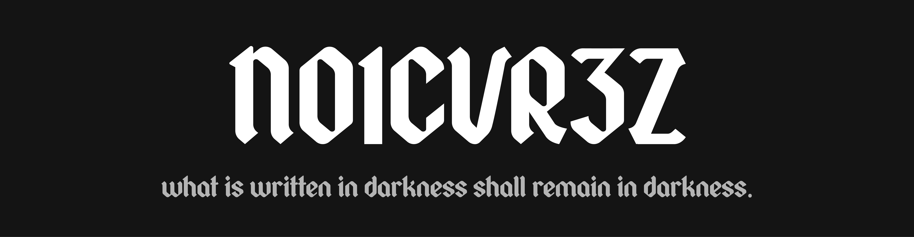

<p align="center">
  
</p>

# n01cvr3z

> *what is written in darkness shall remain in darkness.*

An offline, encrypted personal diary built with Electron. Designed with a quiet, tired command-line aesthetic, authenticated per-entry AES-256-GCM encryption, reminders for your future self, and full RTL text support.

---

## Features

- **Authenticated Cryptography**: Entries are sealed with **AES-256-GCM** using Node.js's built-in `crypto` module (zero external npm crypto libraries). Keys are derived using **PBKDF2** (SHA-512, 100,000 iterations, 32-byte salt).
- **Per-Entry Passwords**: Every thought can carry its own distinct password. Nothing is stored in plaintext except what you deliberately choose to leave behind.
- **Whispers for Your Future Self**: Leave an unencrypted hint attached to each entry to jog your memory when you return years later.
- **Bi-Directional / RTL Support**: Automatic RTL text detection (`dir="auto"`) for Persian, Arabic, and Hebrew, while maintaining strict LTR for timestamps and passwords.
- **Portable & Offline-First**: 100% self-contained. Fonts (Space Mono) are bundled locally. No analytics, no network calls, strict offline Content Security Policy.
- **Export & Import**: Backup individual entries as `.diary` files or export multiple confessions into a unified `.diary-bundle`.
- **Aesthetic**: Low-contrast terminal design with Space Mono, cold steel-blue accents, scanlines, and the faint flicker of a dying monitor.

---

## File Format (`.diary`)

Each entry is saved as an isolated JSON file in your system's `userData/entries/` directory:

```json
{
  "version": 1,
  "id": "e4b6c867-0c58-4566-a6e5-4d2bc33dfc29",
  "createdAt": "2026-10-30T22:30:00.000Z",
  "updatedAt": "2026-10-30T22:30:00.000Z",
  "hint": "the sound of rain on the window",
  "encryption": {
    "algorithm": "aes-256-gcm",
    "kdf": "pbkdf2",
    "kdfIterations": 100000,
    "kdfHash": "sha512",
    "salt": "<base64>",
    "iv": "<base64>",
    "authTag": "<base64>"
  },
  "ciphertext": "<base64>"
}
```

> **Note**: The `hint` field is stored unencrypted so it can be previewed before unlocking. Do not write passwords or sensitive secrets into the hint field.

---

## Getting Started

### Prerequisites

- [Node.js](https://nodejs.org/) (v18 or newer recommended)
- npm

### Running from Source

```bash
# Clone the repository
git clone https://github.com/your-username/N01CVR3Z.git
cd N01CVR3Z

# Install dependencies
npm install

# Start the application
npm start
```

### Building the Standalone `.exe`

To package a standalone, portable Windows executable that requires no installation:

```bash
npm run build
```

The resulting binary will be placed at:
```text
dist/N01CVR3Z.exe
```

---

## Project Structure

```text
N01CVR3Z/
├── main.js                  # Electron main process & IPC handlers
├── preload.js               # Isolated context bridge API
├── package.json             # Build configuration & scripts
├── src/
│   ├── core/
│   │   ├── crypto.js        # AES-256-GCM + PBKDF2 encryption/decryption
│   │   ├── storage.js       # Diary entry CRUD & disk management
│   │   └── export.js        # Export / import dialogs and bundle serialization
│   └── renderer/
│       ├── index.html       # Terminal interface shell
│       ├── fonts/           # Locally bundled Space Mono fonts
│       ├── js/
│       │   ├── app.js       # UI state machine & event listeners
│       │   ├── boot.js      # Terminal boot typewriter sequence
│       │   └── ui.js        # DOM manipulation, modal, & format helpers
│       └── styles/
│           ├── main.css     # Terminal theme, dark palette, & layout
│           ├── crt.css      # Scanline overlay & slow screen flicker
│           └── fonts.css    # Local @font-face declarations
```

---

## Security Model

1. **Zero-Knowledge Architecture**: The application never writes derived encryption keys or passwords to disk or logs.
2. **Authenticated Tamper Detection**: AES-GCM validates the cryptographic authentication tag (`authTag`). If a `.diary` file is corrupted or modified by a third party, decryption safely fails.
3. **Memory Hygiene**: Decrypted plaintext is cleared from renderer memory as soon as the view is closed.
4. **Isolated Context Bridge**: Context isolation is enabled and `nodeIntegration` is disabled in the renderer window.

---

## License

MIT
